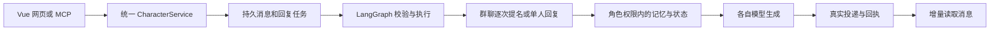

# 项目结构与运行方式

## 模块边界

| 目录 | 职责 |
| --- | --- |
| `frontend/src` | Vue 页面、设置面板、消息增量同步与登录 |
| `backend/app/api` | HTTP 路由、请求校验和应用装配 |
| `backend/app/accounts` | 账号、会话和登录 |
| `backend/app/characters` | 人物配置、统一服务与单个角色生成 |
| `backend/app/conversations` | 消息、投递、收件任务、通道权限与隐藏私聊 |
| `backend/app/world` | 现实时间、行动与场景、事实及知情范围 |
| `backend/app/memory` | 近期记忆、归档、权限过滤和检索 |
| `backend/app/runtime` | LangGraph 发言调度、角色动作和主动联系 |
| `backend/app/infrastructure` | 数据库、迁移、密钥、后台任务及用量统计 |
| `backend/app/mcp` | MCP 工具、客户端凭据及权限 |
| `migrations` | Alembic 版本迁移 |

根目录 `server.py` 是旧入口的兼容层，真实入口为 `backend.app.main:app`。旧管理脚本仍可执行；旧模块的对应关系见 `backend/MODULE_MAP.json`。业务模块通过 `core/context.py` 的上下文和 `core/services.py` 的应用服务访问依赖，不再导入根目录 server。

API 装配层仍保留部分兼容函数和描述功能。网页统一使用 Vue 构建产物，旧 HTML、设置脚本及其专用测试已移除；未构建时明确返回 503 和构建提示，不回退到过期界面。通知脚本与 Service Worker 仍由新版使用。此次没有更改角色人设。

## 一条消息怎样执行



外层图只保存任务标识和阶段，不把提示词、聊天原文或密钥写入图状态。使用官方 SQLite / PostgreSQL checkpoint saver；已有数据库收件任务、租约和消息幂等标识仍负责实际投递一致性。群聊用子图逐次决定下一位角色，每次生成后重新判断是否继续。群聊调度只读获准的公开上下文；角色回复由各自配置的模型生成。

图不会让未送达的消息自动变成事实。隐藏私聊、网站会话和外部客户端仍有不同知情范围。

## 记忆检索

默认保留现有词法检索，不增加 Embedding API 调用。主页模型配置中的 Embedding 模型为空时不开启向量检索。

填写后，LlamaIndex 负责切片和向量检索，再与词法排名融合。候选记录必须先经过人物/通道权限过滤，不能通过向量搜索绕开私聊权限。向量及文本摘要指纹保存在数据库，原文继续由原有记录管理；当前没有引入独立向量服务或 pgvector。索引在进程内按获准候选集合建立。

Embedding 接口使用主页的连接和密钥。首次检索可能为全部获准候选记录建立向量，耗时和费用取决于历史量；批量请求并缓存结果，后续复用。服务不支持 Embedding 或请求失败时退回词法检索，并记录不含正文的错误类别。更换模型后使用新的缓存指纹。重置当前故事会清除该用户的派生向量缓存，其他故事原文不变。

## 数据库迁移

启动时通过 Alembic 升级到最新版本，兼容原有 SQLite / Neon PostgreSQL。首个版本接管现有表并补齐新表，不清空聊天。PostgreSQL 迁移使用事务级锁，避免并发初始化。

也可在已配置目标数据库的环境运行：

```powershell
python -m backend.app.infrastructure.migrate
```

这条命令只更新表结构，不会把本地聊天上传到 Neon。`DATABASE_URL` 决定目标。生产迁移由应用启动自动执行；连接信息不放入 `alembic.ini`。未来增加表结构需新增版本迁移；当前 env.py 要求由程序注入连接，不能直接使用未配置的离线 Alembic 命令。

LangGraph 的 SQLite checkpoint 文件与聊天数据库相邻；PostgreSQL 使用官方 saver 自身的表。图状态与聊天数据库均需纳入实际部署的持久存储安排。

## 构建与验证

Python 直接依赖见 `requirements.txt`，可重复安装版本见 `requirements.lock`；前端锁文件为 `frontend/package-lock.json`。Docker 使用 Node 构建网页，再复制到 Python 镜像，运行时不需要 Node。

```powershell
python -m unittest discover -s tests -p "test_*.py"
cd frontend
npm ci
npm run build
npm test
npm run test:e2e
```

浏览器测试使用独立测试数据库和假模型，不访问生产聊天。真实模型验证脚本 `tests/live_platform_check.py` 使用本机有效配置，但在隔离数据库中执行、中性测试人设，不修改真实聊天。

Deep Agents 和技能执行未加入日常聊天链路；以后需要多步骤调查、工具执行或长期任务时，可在运行时增加独立任务图。当前优先保持消息一致性和可控的模型消耗。


## 运行效率更新

网页使用 `/api/events` SSE 接收当前账号的无正文刷新信号，再由原有权限接口读取消息和状态。重新连接时读取快照补齐遗漏；隐藏页面关闭连接，恢复时重新同步。消息和场景保留30秒兜底查询。进程内事件总线适用于当前单工作进程部署；多进程间仍通过兜底查询同步，扩容时需要共享事件总线。

LangGraph 的图实例与 checkpoint 存储按数据库复用；PostgreSQL 使用连接池。初始化按数据库首次使用执行，正常关闭或 engine dispose 时释放资源，SQLite 关闭前收拢 WAL。任务上下文独立，不把不同人物的执行器放入共享图状态。

同一通道的待执行场景更新合并到最新边界，保留这段新增历史的动作证据；运行中的任务不撤销，跨私聊不混合。已有版本检查继续阻止过期结果覆盖新状态。

开启 Embedding 后，首次索引在后台预热，当前回答先使用词法检索。相同获准候选集合复用索引；顺序追加的记录只插入新节点，压缩、删除或候选范围变化时在后台重建，复用切片和持久向量缓存。后台队列有界，失败短暂退避；重置会使旧的后台结果失效。查询本身的向量转换仍可能需要提供商请求。

服务能力分为 models、prompts、world、generation 和 api；业务模块只取得相应能力，不再取得整个 HTTP 应用。能力绑定保留动态替换以支持集成测试。

回归验证包括事件账号隔离和事务回滚、图复用、场景合并、预算结算、追加索引和中性日常聊天一致性。浏览器测试验证后台消息在5秒内到达，不依赖30秒兜底轮询。
