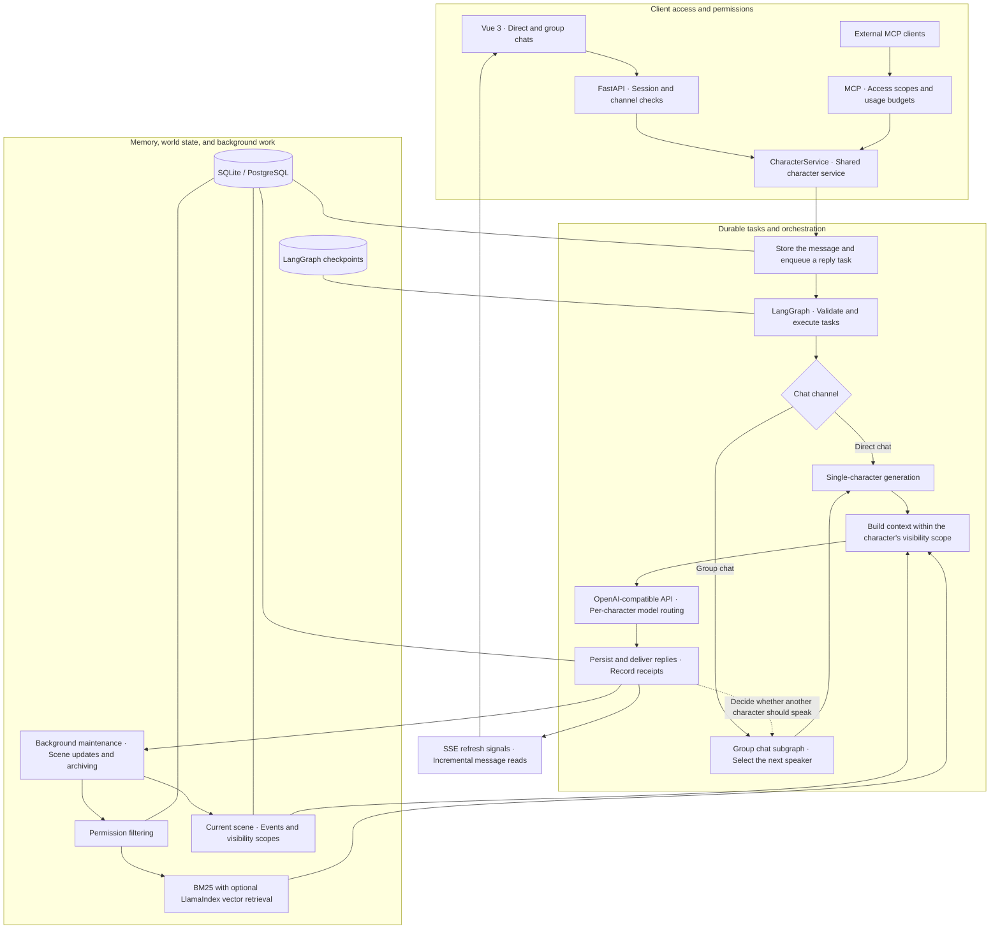

# Character Chat · Multi-Character AI Conversation Platform

[简体中文](README.md) · **English**

Character Chat is a full-stack platform for multi-character AI conversations with long-term memory and persistent world state. In group chats, the system selects the next speaker dynamically and builds context from information that character is allowed to access. A durable task queue handles replies and background state updates. Web and MCP clients use the same character service.

**[Live demo](https://private-character-chat.onrender.com)** · [Local setup](#local-setup) · [Deployment and documentation](#deployment-and-documentation)

The live instance requires an invitation to register. Ask the site administrator for an invitation code, then configure your model connection after signing in. The first visit may take longer while Render starts the service.

## Features



| Capability | Implementation |
| --- | --- |
| Multi-character conversations | Direct and group chats with dynamic speaker selection and separate text model settings per character. |
| Long-term memory and state | Retrieve historical evidence within character and conversation permissions, then combine it with the current scene and confirmed events. |
| Asynchronous messaging | Persist reply tasks, synchronize messages incrementally, and optionally allow characters to initiate contact. |
| Multimodal output and MCP | Configure image and speech models independently. External clients use scoped MCP credentials with usage limits. |

## Local setup

Install Git, Node.js 22 with npm, and uv. To generate replies, have an OpenAI-compatible text model endpoint, model name, and API key ready.

### Windows

Run in PowerShell.

```powershell
git clone https://github.com/gg239629/character-chat.git
cd character-chat
powershell -ExecutionPolicy Bypass -File .\start_local.ps1
```

The script creates a project-local Python environment, installs locked dependencies, builds the frontend, and starts the local server.

<details>
<summary>macOS / Linux</summary>

Run in a terminal.

```bash
git clone https://github.com/gg239629/character-chat.git
cd character-chat
uv venv --python 3.13
uv pip install --python .venv/bin/python -r requirements.lock
npm --prefix frontend ci
npm --prefix frontend run build

export ENABLE_USER_ACCOUNTS=true
export REGISTRATION_MODE=invite
export REGISTRATION_INVITE_CODE="$(.venv/bin/python -c 'import secrets; print(secrets.token_urlsafe(24))')"
printf 'Local registration invite: %s\n' "$REGISTRATION_INVITE_CODE"
.venv/bin/python -m uvicorn backend.app.main:app --host 127.0.0.1 --port 8788
```

</details>

1. Open [http://127.0.0.1:8788](http://127.0.0.1:8788). On first use, register with the invitation code printed in the terminal, then sign in.
2. From the lower-left corner of the home page, open **设置 → 模型 → 文字** (Settings → Model → Text). Enter the endpoint, model name, and API key, then test the connection and save.
3. Open **大家一起** for the group chat or select a character for a direct chat.

Accounts and chats are stored locally in `data/chat.db`. On Windows, an existing `data/local-accounts.json` supplies the invitation code.

## Deployment and documentation

The repository includes a `Dockerfile` and a Render Blueprint (`render.yaml`). On Render, select **New → Blueprint**, connect the repository, and configure the PostgreSQL `DATABASE_URL`, a persistent `APP_ENCRYPTION_KEY`, and the model and notification variables specified in the Blueprint. Use `/healthz` to check the running service.

The linked technical guides are in Simplified Chinese.

| Topic | Documentation |
| --- | --- |
| Deployment and persistence | [Database and migrations](docs/guides/DATABASE.md) · [Accounts and invite-based registration](docs/guides/ACCOUNTS.md) |
| Conversations and characters | [Direct and group chats](docs/guides/CHAT_CHANNELS.md) · [Proactive messages](docs/guides/ACTIVE_MESSAGES.md) · [World state](docs/design/WORLD_STATE.md) |
| Models and integrations | [Image generation](docs/guides/IMAGES.md) · [MCP integration](docs/guides/MCP.md) · [Model usage](docs/design/EFFICIENCY.md) |
| Development and maintenance | [System architecture](docs/design/ARCHITECTURE.md) · [Documentation and maintenance commands](docs/README.md) |

The frontend uses Vue 3, TypeScript, and Vite. The backend uses FastAPI and LangGraph, with SQLite for local development and PostgreSQL for cloud deployment.
