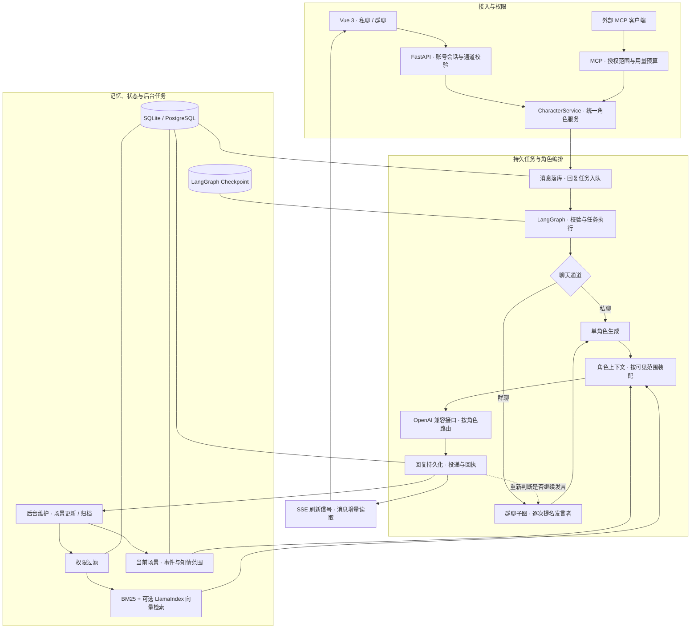

# Character Chat · 多角色 AI 会话平台

**简体中文** · [English](README.en.md)

Character Chat 是一个支持多角色协作、长期记忆和持续世界状态的全栈 AI 会话平台。系统在群聊中动态决定下一位发言角色，为每个角色构建权限范围内的上下文，并通过持久化任务处理消息、回复和后台状态更新。Web 与 MCP 客户端共用角色服务。

**[在线体验](https://private-character-chat.onrender.com)** · [本地启动](#本地启动) · [部署与文档](#部署与文档)

在线站点采用邀请注册。新用户请向站点管理员获取邀请码，登录后在设置里填写自己的模型配置。首次访问可能需要等待 Render 唤醒服务。

## 功能



| 能力 | 实现 |
| --- | --- |
| 多角色会话 | 支持私聊和群聊。群聊按最新发言动态调度，各角色可独立配置文字模型。 |
| 长期记忆与状态 | 按角色和会话权限检索历史证据，结合当前场景和已确认事件生成回复。 |
| 异步消息与主动触达 | 接收消息后持久化回复任务，支持增量同步和可选的角色主动联系。 |
| 多模态与 MCP | 支持独立配置生图和语音模型，外部客户端可使用有范围和额度限制的 MCP 授权。 |

## 本地启动

准备 Git、Node.js 22（含 npm）、uv，以及一套可用的 OpenAI 兼容文字模型配置（接口地址、模型名称和 API Key）。

### Windows

在 PowerShell 中运行：

```powershell
git clone https://github.com/gg239629/character-chat.git
cd character-chat
powershell -ExecutionPolicy Bypass -File .\start_local.ps1
```

脚本会创建项目内的 Python 环境、安装锁定依赖、构建前端并启动本地服务。

<details>
<summary>macOS / Linux</summary>

在终端运行：

```bash
git clone https://github.com/gg239629/character-chat.git
cd character-chat
uv venv --python 3.13
uv pip install --python .venv/bin/python -r requirements.lock
npm --prefix frontend ci
npm --prefix frontend run build

export ENABLE_USER_ACCOUNTS=true
export REGISTRATION_MODE=invite
export REGISTRATION_INVITE_CODE="$(.venv/bin/python -c 'import secrets; print(secrets.token_urlsafe(24))')"
printf '本地注册邀请码：%s\n' "$REGISTRATION_INVITE_CODE"
.venv/bin/python -m uvicorn backend.app.main:app --host 127.0.0.1 --port 8788
```

</details>

1. 打开 [http://127.0.0.1:8788](http://127.0.0.1:8788)，首次使用时用终端显示的临时邀请码注册，再用自己的账号登录。
2. 进入主页左下角的 **设置 → 模型 → 文字**，填写接口地址、模型名称和 API Key，测试连接并保存。
3. 选择「大家一起」进入群聊，或打开任意一位角色的私聊。

账号与聊天记录保存在本地 `data/chat.db`，重启后可用原账号登录。Windows 上已有 `data/local-accounts.json` 的安装继续使用文件中的邀请码。

## 部署与文档

仓库提供 `Dockerfile` 和 Render Blueprint（`render.yaml`）。在 Render 中选择 **New → Blueprint** 并连接仓库，配置 PostgreSQL 的 `DATABASE_URL`、稳定的 `APP_ENCRYPTION_KEY` 和 Blueprint 要求的模型及通知变量。部署后用 `/healthz` 检查服务状态。

| 主题 | 文档 |
| --- | --- |
| 部署与持久化 | [数据库与迁移](docs/guides/DATABASE.md) · [账号与邀请注册](docs/guides/ACCOUNTS.md) |
| 聊天与角色 | [私聊和群聊](docs/guides/CHAT_CHANNELS.md) · [主动消息](docs/guides/ACTIVE_MESSAGES.md) · [世界状态](docs/design/WORLD_STATE.md) |
| 模型和集成 | [图片生成](docs/guides/IMAGES.md) · [MCP 接入](docs/guides/MCP.md) · [模型用量](docs/design/EFFICIENCY.md) |
| 开发与维护 | [项目架构](docs/design/ARCHITECTURE.md) · [完整文档与维护命令](docs/README.md) |

前端使用 Vue 3、TypeScript 和 Vite，后端使用 FastAPI 和 LangGraph。本地使用 SQLite，云端使用 PostgreSQL。
